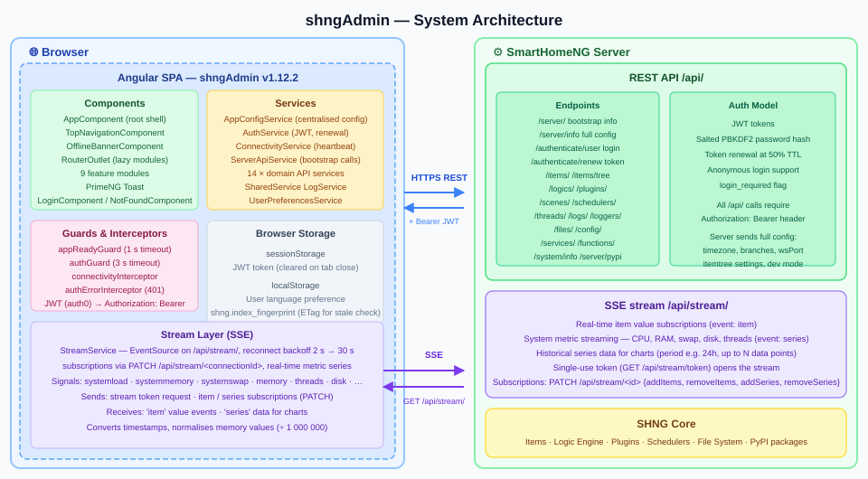
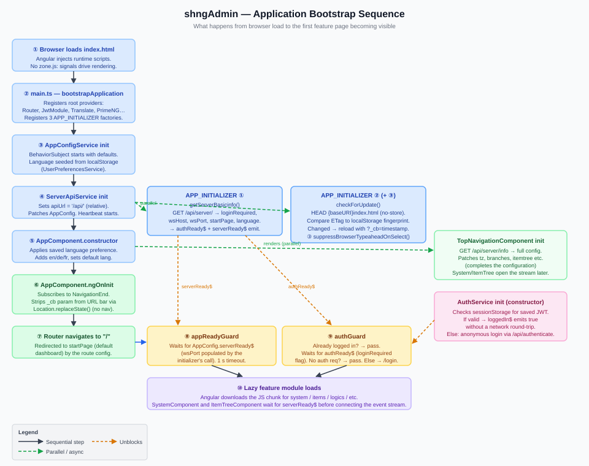
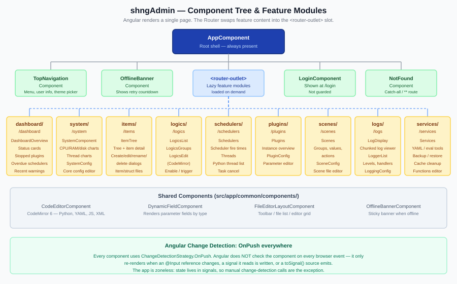
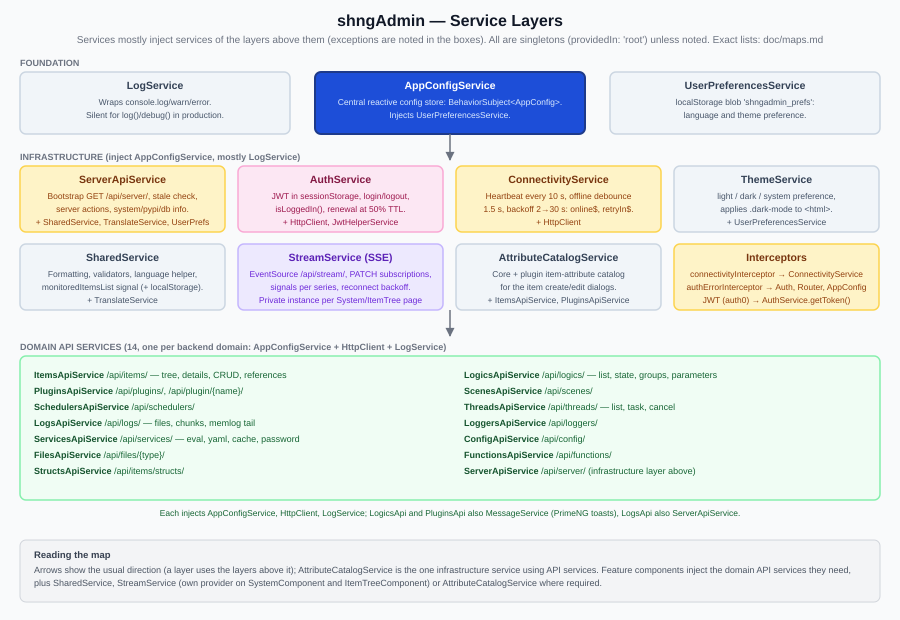
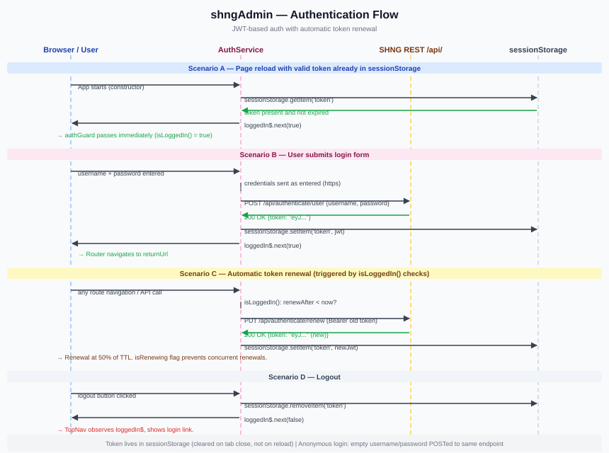
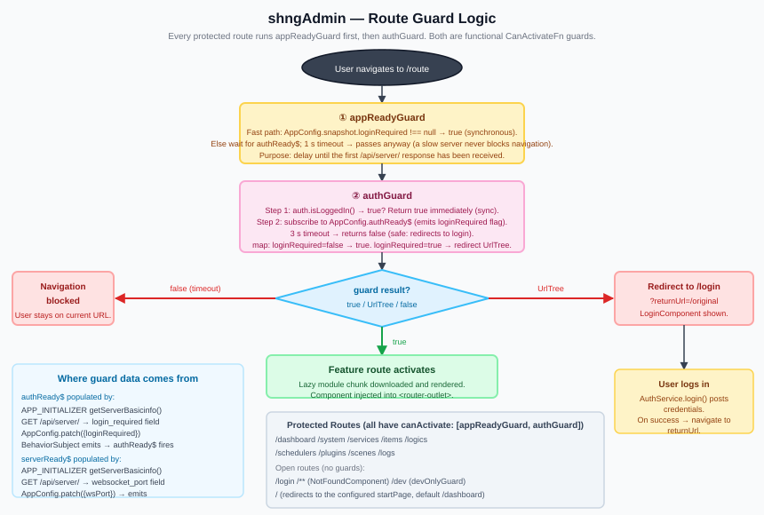
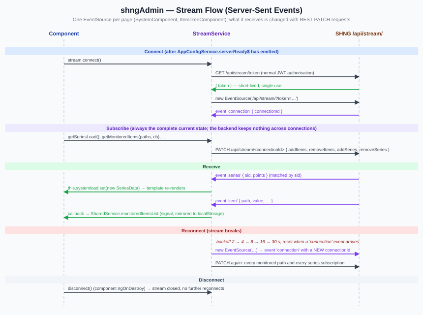
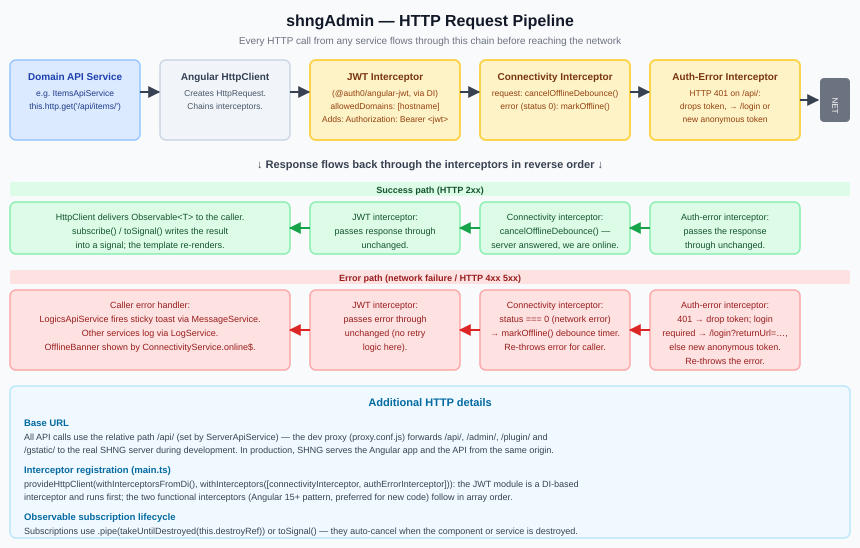

# shngAdmin — Architecture Guide

> **Audience**: A Python developer who understands how web applications work conceptually, but is new to Angular and TypeScript.  This guide assumes you can read code but do not yet know Angular idioms.
>
> **Goal**: By the end you should be able to navigate the codebase confidently, understand why things are structured the way they are, and make changes without breaking the parts you didn't touch.
>
> **Scope**: concepts, rationale and how-tos. The lists that go stale quickly (routes, backend endpoints per service, model fields, file catalogue, who-injects-what) are not written by hand: they are generated into [maps.md](maps.md), see Section 20.

---

## Table of Contents

1. [Big Picture](#1-big-picture)
2. [Technology Stack](#2-technology-stack)
3. [Application Bootstrap Sequence](#3-application-bootstrap-sequence)
4. [Angular Fundamentals (the 30-second version)](#4-angular-fundamentals-the-30-second-version)
5. [Component Tree](#5-component-tree)
6. [Service Layer](#6-service-layer)
7. [Authentication](#7-authentication)
8. [Route Guards](#8-route-guards)
9. [Stream Layer (SSE)](#9-stream-layer-sse)
10. [HTTP Pipeline](#10-http-pipeline)
11. [Reactive State: Signals and Observables](#11-reactive-state-signals-and-observables)
12. [Change Detection: Zoneless + OnPush](#12-change-detection-zoneless--onpush)
13. [Theming (Light / Dark / System)](#13-theming-light--dark--system)
14. [Internationalisation (i18n)](#14-internationalisation-i18n)
15. [Feature Modules In Depth](#15-feature-modules-in-depth)
16. [Data Models](#16-data-models)
17. [Testing Approach](#17-testing-approach)
18. [Development Setup and Tooling](#18-development-setup-and-tooling)
19. [Where to Make Common Changes](#19-where-to-make-common-changes)
20. [Reference Maps (generated)](#20-reference-maps-generated)

---

## 1. Big Picture

shngAdmin is a **Single-Page Application (SPA)** that runs entirely in the browser.  It is the administrative front-end for the [SmartHomeNG](https://www.smarthomeng.de/) home-automation server.

The server (written in Python) exposes two interfaces:
- A **REST API** at `/api/` for configuration reads and writes.
- A **Server-Sent-Events stream** at `/api/stream/` for real-time metric streaming and item-value subscriptions (changed with `PATCH /api/stream/<connectionId>`, see Section 9).

The Angular app communicates with both, renders the results as interactive pages, and sends commands back (restart server, save a logic file, change a setting, etc.).

```
Browser                              SmartHomeNG Python server
  ┌──────────────────────┐              ┌────────────────────┐
  │  Angular SPA         │──HTTPS REST─▶│  REST API  /api/   │
  │  shngAdmin           │◀─────────────│                    │
  │                      │              │                    │
  │                      │◀─────SSE─────│  SSE /api/stream   │
  └──────────────────────┘              └────────────────────┘
```



### 1.1 What kind of program is this?

Before anything Angular-specific, it helps to know what category of program this is. In a traditional web app (Django, Flask with Jinja templates) the server renders a full HTML page for every click. In a SPA the server sends one HTML file plus a pre-compiled JavaScript bundle once; after that the browser rewrites the DOM itself and only exchanges JSON with the backend, much like `requests.get()` in Python, but running inside the browser:

```
TRADITIONAL WEB APP (Django/Flask)          SINGLE-PAGE APPLICATION (Angular)
  click "Users" → GET /users/                 load once     → GET /  (index.html + JS bundle)
                ← server renders full page    click "Items" → JavaScript rewrites the DOM,
  click "Edit"  → GET /users/5/edit/                          then GET /api/items/list/
                ← server renders full page                  ← JSON only
```

The backend (SmartHomeNG's REST API) never knows or cares about page transitions. It only sees JSON API calls and the one event stream.

### 1.2 One interaction, end to end

What happens when you open `/logics` and press **Trigger** on a logic:

1. The Router sees the URL change and runs `appReadyGuard` and `authGuard` (Section 8). Both pass at once on a warm app.
2. The Router activates `LogicsListComponent`; Angular creates it and `inject()` hands it `LogicsApiService`, `Router` and the other services it declared.
3. The component holds the logics as a signal fed by an Observable: `toSignal(merge(of(undefined), refresh$).pipe(switchMap(() => api.getLogics())))`. Subscribing starts `GET /api/logics/`.
4. `LogicsApiService.getLogics()` builds the URL from `AppConfigService.apiUrl`. On the way out the request passes the interceptors (Section 10): the JWT is attached, the connectivity interceptor watches the result.
5. The response arrives; the signal receives it and `computed()` signals derive the user logics, system logics and the group structure. Writing to the signal schedules a re-render (Section 12).
6. The template renders `@for` loops over those signals.
7. A click on **Trigger** calls `triggerLogic(name)` → `LogicsApiService.setLogicState(name, 'trigger')` → `PUT /api/logics/<name>?action=trigger`. On success the component calls `refresh$.next()`, which makes the `toSignal()` pipeline fetch the list again, and the cycle repeats from step 4.

---

## 2. Technology Stack

| Layer | Technology | Role |
|---|---|---|
| Language | TypeScript 5.9 | Compiled to JavaScript; adds static types |
| Framework | Angular 21 (**zoneless**) | Component framework, DI, routing, HTTP — no `zone.js` (see Section 12) |
| UI components | PrimeNG 21 | Ready-made UI widgets (dialogs, tabs, tree, pick-list…) — but most list *tables* are plain HTML `<table>` with Bootstrap classes, not PrimeNG's `p-table` (see Section 15) |
| Icons | PrimeIcons + FontAwesome (`@fortawesome/angular-fontawesome` 4) | Icon fonts |
| Charts | Chart.js 4 | Canvas-based graphs for system metrics |
| Code editing | CodeMirror 6 | Embedded editor (Python, YAML, JS, XML) |
| Translation | ngx-translate | Runtime language switching (en/de/fr) |
| Auth tokens | @auth0/angular-jwt | JWT decode, expiry check, attaches the `Authorization` header via DI |
| Testing | Jest 30 + jest-preset-angular (**zoneless** test environment) | Unit tests; runs in Node (no browser needed) |
| Linting | ESLint + angular-eslint | Code quality |
| Formatting | Prettier | Consistent code style |
| Git hooks | Husky + lint-staged | Auto-format on commit; format, lint, type check, tests and e2e visual regression before a push to `develop`/`master` (Section 18) |

**TypeScript vs Python**: TypeScript is structurally typed — the compiler checks that objects have the right fields and method signatures, but at runtime it is plain JavaScript.  Interfaces (like `ServerInfo`) are compile-time only; they vanish after compilation.

---

## 3. Application Bootstrap Sequence

"Bootstrap" here means everything that happens from the moment the browser downloads the page until the first feature screen is visible.

### 3.1 Browser loads `index.html`

Angular's build tool (`@angular/build`, esbuild-based) produces a single `index.html` that references bundled JavaScript files.  The browser fetches and executes them.

There is **no `zone.js`** in this bundle.  Older Angular apps loaded it first to patch every async browser API (`setTimeout`, `Promise`, `fetch`, WebSocket) so the framework could tell when to re-render.  This app doesn't need that — see Section 12.

### 3.2 `main.ts` — `bootstrapApplication`

This is the entry point, equivalent to Python's `if __name__ == '__main__'`.  It calls `bootstrapApplication(AppComponent, { providers })`, which:
- Creates Angular's **dependency-injection container** (called the "injector").  Think of it as a dict that maps class names to singleton instances.
- Registers `provideZonelessChangeDetection()` — the change-detection strategy for the whole app (Section 12).
- Registers all **root-level providers**: the Router, translation service, JWT module, PrimeNG theme, HTTP client, and a few singleton services.
- Runs three `APP_INITIALIZER`s **in parallel, before the router starts its first navigation**:
  1. `ServerApiService.getServerBasicinfo()` — `GET /api/server/`. Critically, this single response patches `clientIp`, `wsHost`, `wsPort`, `loginRequired`, `startPage` and the language defaults into `AppConfigService` all at once. Doing this as an `APP_INITIALIZER` (rather than from a component's `ngOnInit`, which is how it used to work) means the router's own guards never have to wait on a component to even exist first.
  2. `ServerApiService.checkForUpdate()` — `HEAD`s `index.html`, compares its `ETag`/`Last-Modified` fingerprint against the one cached from the previous load (`localStorage['shng.index_fingerprint']`). If they differ, a new build has been deployed since this tab last loaded, and the page force-reloads via a cache-busting URL (`?_cb=<timestamp>`; `AppComponent` strips the parameter again after the reload). It uses `document.baseURI`, so it also works when the app is mounted under a sub-path.
  3. `suppressBrowserTypeaheadOnSelect()` — keeps the find-as-you-type feature of Firefox-family browsers from hijacking keys typed on a focused select.
- Renders `AppComponent` into the `<app-root>` element in `index.html`.



### 3.3 Singleton services instantiate

Before any component runs, Angular creates root-provided services as they're first injected. The important ones for startup:

**`AppConfigService`** — creates a `BehaviorSubject<AppConfig>` seeded with safe defaults.  Language is pre-populated from the user's saved preference (`UserPreferencesService`, `localStorage`) so the UI renders in the right language even before the server responds.

**`ServerApiService`** (constructor) — patches `apiUrl` (the relative path `/api/`), `dataUrl` (the injected `BASE_URL`, i.e. the page's `<base href>`) and `hostIp` into `AppConfigService`.

**`ConnectivityService`** (constructor) — waits for `AppConfig.ready$` (emits once `apiUrl` is set), then starts the heartbeat timer.

**`AuthService`** (constructor) — checks `sessionStorage['token']`.  If found and not expired, marks the user as logged in immediately, without a network round-trip.

### 3.4 `AppComponent` renders

Angular creates the root component. Its template hosts `<app-top-navigation>`, `<app-offline-banner>`, and `<router-outlet>` — all present from the first frame.

### 3.5 `TopNavigationComponent` renders (in parallel)

Fires a second, fuller request:

```
GET /api/server/info   →   full ServerInfo  { tz, branches, itemtree settings, developer_mode, … }
```

The response patches the remaining `AppConfigService` fields not already covered by the `APP_INITIALIZER`'s basic-info call. (`serverReady$` has normally emitted already after that call.) `SystemComponent` and `ItemTreeComponent` call `StreamService.connect()` once `serverReady$` has emitted.

### 3.6 Router activates the first route

The Router activates `/`, whose `redirectTo` is a function evaluated at navigation time: it returns `AppConfigService.startPage`, taken from the server's `admin.start_page` setting (default `dashboard`). An unrecognised or stale value falls back to `dashboard` (`resolveStartRoute()` in `app.routes.ts`) instead of redirecting into a 404. The guards run first:
1. `appReadyGuard` — checks `AppConfigService.snapshot.loginRequired !== null`. Because the `APP_INITIALIZER` in 3.2 already resolved before the router started, this is almost always already `true` and the guard passes synchronously with no wait at all. A 1-second fallback timeout exists only for the rare case where the guard is evaluated before that `APP_INITIALIZER` has finished.
2. `authGuard` — checks login state / `authReady$` (3-second timeout, falls back to redirecting to `/login`).

Once both pass, Angular downloads the target feature chunk and renders it.

---

## 4. Angular Fundamentals (the 30-second version)

### Components

A **component** is a Python class with a decorator that links it to an HTML template and a CSS file. When Angular renders the component, it evaluates the template (data binding, loops, conditionals) and produces DOM nodes.

Every component in this app uses **signals** for its reactive state and `ChangeDetectionStrategy.OnPush` — there is no other pattern in use (see Section 12 for why this matters more here than in a typical Angular app).

```typescript
@Component({
  selector: 'app-example',       // use as <app-example> in HTML
  templateUrl: './example.component.html',
  styleUrls: ['./example.component.css'],
  changeDetection: ChangeDetectionStrategy.OnPush,
  imports: [FormsModule, ...],  // what this component uses (standalone, no NgModules)
})
export class ExampleComponent implements OnInit {
  private readonly apiService = inject(ItemsApiService);  // DI: get singleton

  readonly items = signal<Item[]>([]);   // reactive state — a getter-like function

  ngOnInit() {  // called once after the component is created
    this.apiService.getItems().subscribe(items => {
      this.items.set(items);   // writing the signal is what triggers a re-render
    });
  }
}
```

(Illustrative: the real components mostly use `toSignal()` instead of the explicit `subscribe()`, see Section 11.)

In the template, `items` is read as a function call: `{{ items().length }}`, `@for (item of items(); track item.id) { ... }`.

### Dependency Injection

`inject(SomeService)` is how you get singletons. Angular's injector creates `SomeService` once and hands the same instance to every class that asks for it. This is the same concept as Python's dependency-injection containers (e.g. `dependency-injector`), but built into the framework. In Python you would write the equivalent by passing collaborators to `__init__`:

```python
class LogicsComponent:
    def __init__(self, api_service, logger):
        self.api = api_service
        self.log = logger
```

Angular does that wiring for you; the class only declares what it needs (`private readonly api = inject(LogicsApiService)`).

### Angular building blocks in Python terms

| Angular | Python analogy |
|---|---|
| **Component** | A class that owns a piece of the UI: data attributes, methods, and a template (like a Jinja2 file, but tightly coupled to the class). |
| **Service** | A class that does work without a UI: HTTP calls, data transformation, shared state. Created once by the injector, passed to whoever asks. Like a db session or a `requests.Session` handed to a function. |
| **Route / lazy chunk** | Like a URL blueprint in `__init__.py`, except the browser downloads that package's JavaScript only the first time its URL is visited. |
| **Template** | An HTML file with extra syntax (below), like Jinja2. |
| **`signal()`** | A module-level variable whose every read and write is tracked: reading it in a template registers "re-render me when this changes". Read by calling it, `mySignal()`; write with `.set(value)`. |
| **`computed()`** | A `functools.cached_property` that recomputes when the signals it read change. |
| **Observable** | A lazy stream of values, more like a generator than a coroutine: nothing happens until someone subscribes. |
| **`BehaviorSubject`** | An Observable that remembers its last value and replays it to late subscribers. |
| **Guard** | A function that runs before a route activates and may allow, redirect or block it (like a Flask `before_request`). |
| **Interceptor** | HTTP middleware that sees every request and response. |

### Signals vs. Observables

Both represent "a value that changes over time," but they play different roles here:
- **`signal()`** — a synchronous, always-has-a-current-value container. Reading it (`mySignal()`) inside a template or a `computed()` automatically registers that read as a dependency; Angular knows exactly which views to re-check when it changes. This is the default for component state in this codebase.
- **RxJS Observables** — still used for anything inherently asynchronous or event-stream-shaped: HTTP responses, stream (SSE) events, router events, `debounceTime`/`switchMap` pipelines. The bridge between the two is `toSignal()` (Observable → signal, for one-shot or push-based data at a component boundary) and, more rarely, `toObservable()` (signal → Observable).

### Templates

Angular templates are HTML with extra syntax:
- `{{ value }}` — interpolation (like Python f-strings)
- `[property]="expr"` — property binding (one-way, component → DOM)
- `(event)="handler()"` — event binding (DOM → component)
- `@for (item of items(); track item.id) { ... }` — structural control flow (looping)
- `@if (condition) { ... } @else { ... }` — conditional rendering
- `@switch (value) { @case (x) { ... } }` — multi-branch conditional

This app uses the modern `@if`/`@for`/`@switch` block syntax exclusively — the older `*ngIf`/`*ngFor`/`*ngSwitch` structural-directive syntax (which you'll see in most Angular tutorials and in older versions of this app) does not appear anywhere in the current source.

---

## 5. Component Tree

The app renders a fixed shell (`AppComponent`) with a slot (`<router-outlet>`) where the current page's content is swapped in.

### Root shell (`AppComponent`)

Always present. Contains:
- `<app-top-navigation>` — the menu bar
- `<app-offline-banner>` — shown when connectivity is lost
- `<router-outlet>` — where the current page renders
- `<p-toast position="bottom-right">` — PrimeNG toast notification layer

### `TopNavigationComponent`

Renders the horizontal navigation tabs. On init, fetches the full server info. Reflects `AuthService.loggedIn$` to show/hide the login link, shows the connected-server hostname and a context-sensitive Help menu, and reflects `ThemeService.darkMode$` to keep the light/dark/system toggle's own icon in sync (Section 13).

### `OfflineBannerComponent`

Subscribes to `ConnectivityService.online$` and `ConnectivityService.retryIn$`. When `online$` emits `false`, shows a sticky banner at the top with a countdown to the next reconnect attempt. Provides a "Retry now" button.



### Feature modules

Each area of the admin UI is a separate **lazy-loaded route group**. Angular downloads the JavaScript for that route group only when the user navigates there for the first time. All nine are guarded by `[appReadyGuard, authGuard]` at the top-level route only (child routes deliberately don't repeat the guards — see Section 8). The complete route table, including the redirects and the child routes, is generated into [maps.md](maps.md).

| Route | Routes file | What it does |
|---|---|---|
| `/dashboard` | `dashboard/dashboard.routes.ts` | At-a-glance status cards (`DashboardOverviewComponent`); the default landing page, see 3.6 |
| `/system` | `system/system.routes.ts` | Resource-usage dashboard (`SystemComponent`) and core config editor (`SystemConfigComponent`) |
| `/items` | `items/items.routes.ts` | Browse the item tree, view/edit/create/rename/delete items, edit item-definition files, browse structs |
| `/logics` | `logics/logics.routes.ts` | List, group, create, edit, enable/trigger Python logic scripts |
| `/schedulers` | `schedulers/schedulers.routes.ts` | Scheduler fire times (grouped by item/logic/plugin/other) and the Python thread list |
| `/plugins` | `plugins/plugins.routes.ts` | Browse installed plugins, view/edit config, check PyPI requirement status |
| `/scenes` | `scenes/scenes.routes.ts` | View scenes and edit scene definition files |
| `/logs` | `logs/logs.routes.ts` | View log files, configure loggers and log handlers |
| `/services` | `services/services.routes.ts` | YAML checker/converter, eval tester, backup/restore, cache cleanup, functions editor |

A handful of legacy paths (`/item_tree`, `/logics-list`, `/logics-groups`, `/threads`, `/plugins_list`) still redirect to their current locations for old bookmarks. `/dev` (style guide) is only available in development builds (`devOnlyGuard`).

### Folder layout

```
src/app/
├── app.component.*, app.routes.ts, bootstrap.utils.ts   root shell, top-level routes, bootstrap helpers
├── common/            shared by all features
│   ├── services/      AppConfig, Auth, Connectivity, Stream, Theme, Shared, ... and the *-api.service.ts files
│   ├── models/        TypeScript interfaces of the server responses
│   ├── guards/        appReadyGuard, authGuard, devOnlyGuard
│   ├── interceptors/  connectivity, auth-error
│   ├── components/    code-editor, dynamic-field, file-editor-layout, offline-banner
│   ├── directives/    decimal-input
│   └── utils/         input/validation/version helpers
├── dashboard/ system/ items/ logics/ plugins/ scenes/ schedulers/ logs/ services/
│                      one folder per navigation section (each with a *.routes.ts)
├── top-navigation/    navigation bar, Help menu, theme picker (not under common/)
├── login/ no-access/ not-found/   outside the guarded routes
└── dev/               style guide (development builds only)
```

### Shared components

Located in `src/app/common/components/`:

**`CodeEditorComponent`** — wraps CodeMirror 6. Used everywhere the user edits code or config text: logic source, YAML files, struct/scene/item-definition files. Supports Python, YAML, JavaScript, and XML syntax highlighting, autocomplete, and a full-screen mode (toggled by a button or F11; also attempts the browser's native Fullscreen API, falling back to a CSS overlay if that's unavailable — e.g. inside an iframe).

**`DynamicFieldComponent`** — config and plugin parameters can be of many different types (number, bool, string, list, dict, IP address, KNX group address, ...). It renders the right input widget based on the parameter's declared type (used by the plugin configuration editor, the core configuration table and the logic parameter table).

**`AttributeValueInputComponent`** (`items/attribute-value-input/`) — the type-aware input of the item create/edit dialogs, fed by the attribute catalog (Section 6.10).

**`FileEditorLayoutComponent`** — shared grid layout (toolbar, file list, editor slot) of the file-editor pages: item, struct, scene and function configuration.

---

## 6. Service Layer

Services are singleton objects that handle data fetching, state management, and cross-cutting concerns. They are created once by the DI container and shared across all components.

### 6.1 `AppConfigService` — the configuration hub

`src/app/common/services/app-config.service.ts`

This service is the **single source of truth for all runtime configuration**. It holds an `AppConfig` object inside a `BehaviorSubject`. Any part of the app can read the current snapshot synchronously, or subscribe reactively to be notified when it changes.

```typescript
// Synchronous read (use when you just need the current value)
const wsPort = this.appConfig.wsPort;

// Reactive read (use when you need to react to future changes)
this.appConfig.config$.subscribe(cfg => { ... });

// Wait until a specific condition is met
this.appConfig.serverReady$.pipe(take(1)).subscribe(() => {
  // wsPort is now available
});
```

`AppConfig` fields: `loginRequired`, `apiUrl`, `dataUrl`, `hostIp`, `wsHost`, `wsPort`, `clientIp`, `tz`, `tzname`, `tznameST`, `tznameDST`, `coreBranch`, `pluginsBranch`, `itemtreeFullpath`, `itemtreeSearchstart`, `developerMode`, `clickDropdownHeader`, `helpLocalAvailable`, `darkModeDefault`, `resourceGraphPeriod`, `restartStopsOnly`, `systemPowerAvailable`, `corePullAvailable`, `pluginsPullAvailable`, `fallbackLanguageOrder`, `defaultLanguage`, `startPage`.

**Key Observables on AppConfigService:**

| Observable | Emits when | Used by |
|---|---|---|
| `ready$` | `apiUrl` is set (ServerApiService ctor) | ConnectivityService |
| `serverReady$` | `wsPort` is set (normally by the `getServerBasicinfo()` initializer) | `SystemComponent` and `ItemTreeComponent`, which open the event stream |
| `authReady$` | `loginRequired` is set | `appReadyGuard` (fallback path), `authGuard` |
| `config$` | any `patch()` call | anything needing reactive config |

### 6.2 `ServerApiService`

`src/app/common/services/server-api.service.ts`

Handles HTTP calls about the server itself:

- `getServerBasicinfo()` — `GET /api/server/` — called from an `APP_INITIALIZER` before routing starts; patches `loginRequired`, `wsHost`, `wsPort`, `clientIp` (see Section 3.2).
- `getServerinfo()` — `GET /api/server/info` — full config; patches the rest of `AppConfig` (tz, branches, developer mode, etc).
- `getShngServerStatus()` — `GET /api/server/status/` — polled by the Services page.
- `restartShngServer()`, `stopShngServer()`, `poweroffHost()`, `rebootHost()`, `pullCore()`, `pullPlugins()`, `pullAll()` — `PUT /api/server/<action>/`; `getPullStatus()` — `GET /api/server/pull_status`.
- `getSystemStats()` — `GET /api/system/info`; `getDatabaseInfo()` — `GET /api/database/info`; `getPypiInfo()` — `GET /api/server/pypi`.
- `downloadConfigBackup()` — `GET /api/files/backup/` (blob response).
- `checkForUpdate()` — stale-build detection, see Section 3.2.

### 6.3 `AuthService`

`src/app/common/services/auth.service.ts`

Manages the JWT lifecycle. See Section 7 for the full auth flow.

Key public API:
- `isLoggedIn()` — synchronous check; also triggers token renewal if the token is past the halfway point of its lifetime.
- `login(credentials)` — returns `Observable<boolean>`.
- `logout()` — clears token from memory and `sessionStorage`.
- `loggedIn$` — `BehaviorSubject<boolean>`; `TopNavigationComponent` subscribes to update the UI.
- `getToken()` — read by the JWT module's `tokenGetter` (Section 10.1).

### 6.4 `ConnectivityService`

`src/app/common/services/connectivity.service.ts`

Monitors whether the SHNG server is reachable. Runs a silent heartbeat `GET /api/server/` every 10 seconds. When a request fails (status 0 = network unreachable), it starts a debounce timer (1.5 s) before declaring the server offline, because a cancelled XHR (e.g. Angular destroying a component) also produces status 0.

On going offline: stops the heartbeat, starts an exponential-backoff retry sequence (2 → 4 → 8 → 16 → 30 seconds). Publishes countdown ticks on `retryIn$`.

Public Observables:
- `online$` — `BehaviorSubject<boolean>`: `OfflineBannerComponent` subscribes to show/hide.
- `retryIn$` — `BehaviorSubject<number>`: countdown in seconds shown in the banner.

### 6.5 `LogService`

`src/app/common/services/log.service.ts`

Wraps `console.log`, `console.warn`, and `console.error`. In production builds, `log()` and `debug()` calls are silenced; `warn()`/`error()` always go through. Always use `LogService` instead of `console.log` directly, so logs don't leak into production.

### 6.6 `ThemeService`

`src/app/common/services/theme.service.ts`

Owns the light/dark/system theme preference. See Section 13 for the full picture. Public API: `preference$`/`darkMode$` (Observables), `preference`/`darkMode` (getters), `setPreference(pref)`, `cycle()` (Light → Dark → System → Light, used by the compact mobile toggle), `applyServerDefault()`.

### 6.7 `SharedService`

`src/app/common/services/shared.service.ts`

A grab-bag of utilities with no HTTP calls of its own:
- `ageToString()`, `displayDateTime()` — human-readable time formatting.
- `is_knx_groupaddress()`, `is_ipv4()`, `is_ipv6()`, `is_mac()`, `is_hostname()` — validators used by config/plugin parameter forms.
- `getDescription(dict)` — picks the right language out of a `{de:..., en:..., fr:...}` description object, following the fallback language order.
- `setGuiLanguage()` — switches the active `TranslateService` language.
- `monitoredItemsList` — a `signal` holding the item-tree's live-monitored items. It lives here (a root singleton), not on `ItemTreeComponent` or `StreamService`, because both of those are destroyed and recreated on navigation — this is what lets the monitored-items table survive navigating away and back, and (via a `localStorage['shng.items.monitored']` mirror, paths only) survive a full page reload too.

### 6.8 `UserPreferencesService`

`src/app/common/services/user-preferences.service.ts`

Reads and writes a single `localStorage` key (`'shngadmin_prefs'`, one JSON blob) holding the user's language and theme preference. Seeded into `AppConfigService`/`ThemeService` at startup so both are correct before the server responds.

### 6.9 Domain API services

`src/app/common/services/*-api.service.ts`

There are 14 of these, one per backend domain. They all follow the same pattern:

```typescript
@Injectable({ providedIn: 'root' })
export class ItemsApiService {
  private readonly http = inject(HttpClient);
  private readonly appConfig = inject(AppConfigService);

  getItemTree() {
    return this.http.get(this.appConfig.apiUrl + 'items/tree');
  }

  changeItemValue(itemPath: string, value: unknown) {
    return this.http.put(this.appConfig.apiUrl + 'items/' + itemPath, { value });
  }
}
```

Each service injects `HttpClient`, reads `apiUrl` from `AppConfigService` to build URLs, returns Observables, and holds no state of its own (no caching, no properties beyond the injected deps).

| Service | Backend domain |
|---|---|
| `ItemsApiService` | `/api/items/` — tree, list, details, create/edit/rename/delete, references |
| `LogicsApiService` | `/api/logics/` — list, state control, groups, parameters |
| `PluginsApiService` | `/api/plugins/` (read) and `/api/plugin/{name}/` (write) — config CRUD, state control |
| `ScenesApiService` | `/api/scenes/` — list, reload |
| `SchedulersApiService` | `/api/schedulers/` |
| `ThreadsApiService` | `/api/threads/` |
| `LogsApiService` | `/api/logs/` — file list, chunked reading |
| `LoggersApiService` | `/api/loggers/` — CRUD, levels, handler assignment |
| `ServicesApiService` | `/api/services/` — eval checker, YAML checker/converter, cache orphans |
| `ConfigApiService` | `/api/config/` — core `smarthome.yaml`, `etc/`-migration check |
| `FilesApiService` | `/api/files/{type}/` — generic read/write/delete used by every text-file editor |
| `FunctionsApiService` | `/api/functions/` — user-function reload |
| `StructsApiService` | `/api/items/structs/` — struct definitions (note: nested under `items/`, not its own top-level path) |
| `ServerApiService` | see 6.2 |

There is no `OlddataService` or `/admin/*.json` legacy endpoint layer any more — everything goes through `/api/`. The method-by-method endpoint list is generated into [maps.md](maps.md).

### 6.10 `AttributeCatalogService`

`src/app/common/services/attribute-catalog.service.ts`

Loads the combined core + plugin item-attribute catalog (`ItemsApiService.getCoreItemAttributes()` plus the plugin metadata from `PluginsApiService`) and groups the suggestions by source (`core` or a plugin name). It feeds the attribute autocomplete of the item create/edit dialogs (`items/attribute-browser/`, `items/attribute-value-input/`).



---

## 7. Authentication

shngAdmin uses **JWT (JSON Web Token)** authentication.

### 7.1 How JWT works

A JWT is a signed string that encodes claims (who you are, when it was issued, when it expires). The browser stores it and sends it with every request. The server verifies the signature using its secret key — no session table needed.

Token contents (decoded by `jwtHelper.decodeToken()`): `iat` (issued-at), `exp` (expiry), plus username/role claims.

### 7.2 Password hashing

`AuthService.login()` sends username and password as entered; the API is meant to be reached over https only. The backend checks the password against the `hashed_password` of the http module (salted PBKDF2; legacy unsalted SHA-512 hashes are still accepted). shngAdmin never hashes passwords itself: the Services page and the password dialog of the system configuration call `PUT /api/services/hashpassword/` and `PUT /api/services/checkpassword/`, and plaintext passwords saved with the http configuration are hashed by the backend.



### 7.3 Token storage

The token lives in `sessionStorage['token']` — it survives page reloads in the same tab but is automatically cleared when the tab is closed. This is a deliberate design choice: closing the browser tab acts as a logout.

### 7.4 Anonymous login

If SHNG is configured with `login_required: false`, the app performs an "anonymous login": a POST with empty credentials. The server still issues a JWT, so the same code path handles both cases.

### 7.5 Token renewal

`isLoggedIn()` is called on every route navigation and (indirectly) on API calls. `renewAfter` is set to the halfway point of the token's lifetime (`iat + ttl/2`); once past it, `renewToken()` fires a `PUT /api/authenticate/renew` with the existing token, and the server returns a fresh one. An `isRenewing` flag prevents overlapping renewal requests. If the server ever returns the *same* token from a renewal call, that's treated as "renewal isn't supported server-side" and further attempts stop.

### 7.6 How the token actually gets attached to requests

There is no hand-written interceptor that *adds* the token. `@auth0/angular-jwt`'s `JwtModule.forRoot(...)` is registered in `main.ts`, configured via a `jwtOptionsFactory` (`src/app/bootstrap.utils.ts`) that supplies `tokenGetter: () => authService.getToken()` and `allowedDomains: [window.location.hostname]` (same-origin only — tokens are never sent to third-party URLs). It attaches automatically to every matching request via `provideHttpClient(withInterceptorsFromDi(), ...)`. What happens when the server rejects a token is handled by the auth-error interceptor (Section 10.2).

---

## 8. Route Guards

Guards are functions that run before a route is activated. They can allow, redirect, or block navigation.



All 9 top-level feature routes (`dashboard`, `system`, `items`, `logics`, `schedulers`, `plugins`, `scenes`, `logs`, `services`) have:
```typescript
canActivate: [appReadyGuard, authGuard]
```

placed **only on the parent route** — child routes deliberately don't repeat it, or the wait would multiply with every route segment.

The `/dev` route (style guide) is guarded by `devOnlyGuard` (`src/app/common/guards/dev-only.guard.ts`) instead, which blocks it outside development builds.

### 8.1 `appReadyGuard`

`src/app/common/guards/app-ready.guard.ts`

**Problem it solves**: components need `wsPort` and other server config before they can safely call the API or open the event stream.

**How it works**: fast-path returns `true` synchronously if `AppConfigService.snapshot.loginRequired !== null` — which, because of the `APP_INITIALIZER` described in Section 3.2, is already true by the time routing starts on essentially every real navigation. Falls back to waiting on `authReady$` with a 1-second timeout for the rare edge case where the guard runs before that initializer resolves.

### 8.2 `authGuard`

`src/app/common/guards/auth.guard.ts`

**Problem it solves**: the app might start on a protected route with no token in `sessionStorage`. Redirect to `/login`, but only if login is actually required (SHNG can run without auth).

**How it works**:
1. Fast path: if `auth.isLoggedIn()` returns `true`, pass immediately.
2. Slow path: waits on `authReady$` (3-second timeout, defaults to "login required" on timeout — fails safe).
3. If `loginRequired === false`: pass (anonymous access allowed).
4. Otherwise: return a `UrlTree` for `/login?returnUrl=/original` — Angular redirects automatically.

`LoginComponent` reads the `returnUrl` query parameter after a successful login to navigate back to where the user was trying to go.

---

## 9. Stream Layer (SSE)

Live data does not come from polling and no longer uses a WebSocket. The server pushes it over one Server-Sent-Events stream (`GET /api/stream/`, backend `modules/admin/api_stream.py` in the SmartHomeNG core); the browser changes what it receives with REST `PATCH` requests. The stream provides two things:
1. **Real-time item value updates** — when a sensor value changes in SHNG, it is pushed to the subscribed browser.
2. **System metric streaming** — CPU load, memory, swap, disk usage, thread counts — for the live charts on the System dashboard.



### 9.1 `StreamService`

`src/app/common/services/stream.service.ts`

Responsibilities:
- `connect()` first calls `GET /api/stream/token` (normal JWT authorisation) to mint a short-lived, single-use token, then opens `new EventSource('/api/stream/?token=…')`.
- The server's first event is `connection` with a `connectionId`. The service answers by sending its complete current subscription state (monitored item paths, series subscriptions) with `PATCH /api/stream/<connectionId>` (`{ addItems, removeItems, addSeries, removeSeries }`). A new `connectionId` means the backend knows no subscriptions, so no deltas are tracked across reconnects.
- Incoming events: `item` (passed to the callback registered via `getMonitoredItems()`) and `series` (matched by `sid` against each metric and written to that metric's signal).
- Auto-reconnect with exponential backoff: 2 → 4 → 8 → 16 → 30 seconds, reset when a `connection` event arrives. `disconnect()` closes the stream and stops reconnecting.

The public surface is `signal`s — components read `stream.systemload()` directly in a template rather than subscribing. Each incoming series message publishes a **new** `SeriesData` value (copy-based update), so signal consumers re-render.

**Public signals** (all `signal<SeriesData>`): `systemload`, `systemmemory`, `systemswap`, `memory`, `threads`, `workerThreads`, `idleWorkerThreads`, `activeWorkerThreads`, `disk`.

**Data normalisation**: memory series arrive in bytes and are divided to MB (`/1000/1000`); timestamps are converted to the display format with `SharedService.getTimeStamp()`.

**Instances**: `SystemComponent` and `ItemTreeComponent` each declare their own `providers: [StreamService]`, so each page owns a private stream that is opened after `serverReady$` emits and closed in `ngOnDestroy`. The stream is not shared across pages.

### 9.2 Item monitoring

`ItemTreeComponent.monitorItem(path, true)` calls `StreamService.getMonitoredItems(paths, callback)`. The service compares the paths with its current set and sends one `PATCH` containing only the added and removed paths. The callback writes into `SharedService.monitoredItemsList` (a signal — see 6.7) on every incoming `item` event. Because that list lives on a root singleton and mirrors itself to `localStorage`, the monitored-items table keeps working across both in-app navigation and a full page reload, re-subscribing to the same paths as soon as the new stream announces its `connectionId`.

### 9.3 Series subscriptions

`getSeriesLoad()`, `getSeriesSystemMemory()`, `getSeriesSwap()`, `getSeriesMemory()`, `getSeriesThreads()`, `getSeriesWorkerThreads()` and `getSeriesDisk()` each register a series subscription for the matching `env.*` item (average, period `start` .. `now`, `count` points) with a `PATCH`, and remember it so it is re-sent after a reconnect.

---

## 10. HTTP Pipeline

Every HTTP request passes through a chain of interceptors before it reaches the network, and through the same chain (in reverse) on the way back.



The chain is registered in `main.ts`: `provideHttpClient(withInterceptorsFromDi(), withInterceptors([connectivityInterceptor, authErrorInterceptor]))`. The JWT module is a DI-based interceptor and therefore runs before the functional ones.

### 10.1 JWT attachment (`@auth0/angular-jwt`)

Not a file under `common/interceptors/` — it's a DI-registered module (see Section 7.6). Automatically injects the `Authorization: Bearer <token>` header on every same-origin request.

### 10.2 Auth Error Interceptor

`src/app/common/interceptors/auth-error.interceptor.ts`

The backend answers a request without a valid token (missing, expired, forged) with HTTP 401. For such an `/api/` response (except the login request itself, which the login form handles) the interceptor drops the token; if the server requires a login it navigates to `/login` with the current URL as `returnUrl`, otherwise it fetches a new anonymous token. The error is passed on to the caller unchanged.

### 10.3 Connectivity Interceptor

`src/app/common/interceptors/connectivity.interceptor.ts`

A **functional interceptor** (the modern Angular style):

```typescript
export const connectivityInterceptor: HttpInterceptorFn = (req, next) => {
  connectivity.cancelOfflineDebounce();  // a request is going out — we're probably online
  return next(req).pipe(
    catchError(err => {
      if (err.status === 0) {    // status 0 = network failure (not an HTTP error code)
        connectivity.markOffline();
      }
      return throwError(() => err);  // re-throw so the caller's error handler fires
    })
  );
};
```

The `cancelOfflineDebounce()` call handles a subtle case: Angular destroys a component (e.g. navigating away), which cancels any in-flight HTTP requests. Those cancellations also produce status 0. The debounce (1.5 s window, owned by `ConnectivityService`) prevents this from falsely triggering the offline banner: if the *next* page's requests succeed, the timer is cleared and the banner never shows.

### 10.4 URL construction

API services don't hard-code host:port. They read `appConfig.apiUrl`, the relative path `/api/` set by `ServerApiService`'s constructor, so requests go to the origin that served the app (`appConfig.dataUrl` holds the base URL).

In development, a proxy (`proxy.conf.js`) forwards `/api/`, `/admin/`, `/plugin/` and `/gstatic/` requests from `localhost:4200` to the real SHNG server. In production, SHNG serves the Angular app at the same origin, so no proxy is needed.

---

## 11. Reactive State: Signals and Observables

If you are coming from Python, here's a rough mental model:

| Python | Angular |
|---|---|
| a plain module-level variable, but every read/write is tracked | `signal()` |
| `@functools.cached_property` that recomputes when its inputs change | `computed()` |
| `asyncio.Queue` | `Subject` |
| `asyncio.Queue` with last-value memory | `BehaviorSubject` |
| `async for item in queue` | `.subscribe(item => ...)` |
| `asyncio.gather(...)` | `forkJoin(...)` / `combineLatest(...)` |
| `async with resource` | `takeUntilDestroyed(destroyRef)` |

### The house patterns used throughout this codebase

**One-shot fetch at a component boundary:**
```typescript
readonly items = toSignal(
  this.itemsApi.getItems().pipe(map(response => response ?? [])),
  { initialValue: [] },
);
```
`toSignal()` subscribes when the signal is first read and unsubscribes automatically when the component is destroyed — no `DestroyRef`, no manual `markForCheck()`.

**Refetch-after-action:**
```typescript
private readonly refresh$ = new Subject<void>();
readonly items = toSignal(
  merge(of(undefined), this.refresh$).pipe(switchMap(() => this.itemsApi.getItems())),
  { initialValue: [] },
);
save() {
  this.itemsApi.save(...).subscribe(() => this.refresh$.next());
}
```

**Derived, sortable/filterable view:**
```typescript
readonly sortField = signal('');
readonly filtered = computed(() =>
  [...this.items()].filter(i => i.name.includes(this.filterText())),
);
```
Always a pure `computed()` over a *copy* — never an in-place `.sort()`/mutation of the source array.

**Async subscription that still needs a persistent, user-mutable field:**
```typescript
private readonly destroyRef = inject(DestroyRef);
readonly myEditFilename = signal('');

ngOnInit() {
  this.someApi.getSomething().pipe(takeUntilDestroyed(this.destroyRef)).subscribe(response => {
    this.myEditFilename.set(response.filename);
  });
}
```
`takeUntilDestroyed(this.destroyRef)` still matters for RxJS subscriptions themselves (an Observable pipeline doesn't know to stop just because nothing reads its signal any more) — it automatically unsubscribes when the component is destroyed, no manual `ngOnDestroy` needed.

### The `async` pipe

Templates can still subscribe directly:
```html
@if (data$ | async; as data) {
  <div>{{ data.value }}</div>
}
```
This auto-unsubscribes on destroy, but is used less often than `toSignal()` in this codebase — converting to a signal at the component boundary keeps the rest of the component's logic signal-based too.

---

## 12. Change Detection: Zoneless + OnPush

This app runs **without `zone.js`** (`provideZonelessChangeDetection()` in `main.ts`), and every component uses `ChangeDetectionStrategy.OnPush`.

### What that combination means in practice

Older Angular apps load `zone.js`, which monkey-patches every async browser API (`setTimeout`, `Promise`, `fetch`, WebSocket, DOM events...). Whenever *any* of those fires, anywhere, Zone.js tells Angular "something might have changed — check everything." That's a blunt, effective safety net, but it means components re-render far more often than necessary, and — worse for readability — imperative code that sets `this.foo = bar` and forgets to call `this.cdr.markForCheck()` will *often* still appear to work, because some unrelated zone tick happens to sweep through and pick up the change. The bug only shows up later, unpredictably, when that lucky tick doesn't happen to occur.

Without zone.js, there is no such safety net. A component only re-renders when:
1. A `signal()` it reads (directly, or via a `computed()`) is written to.
2. A DOM event bound in its own template fires (click, input, etc. — Angular's renderer always schedules a check for these, zoneless or not).
3. An Observable used via the `async` pipe emits.
4. Something explicitly calls `ChangeDetectorRef.markForCheck()`/`detectChanges()`.

**This is why the codebase writes to signals rather than plain fields.** `this.items.set(data)` inside an HTTP subscribe callback is not just "idiomatic" here — it is the *only* thing that reliably tells Angular to re-render, because there's no zone tick left to accidentally bail you out. A plain `this.items = data` would compile fine, the field would hold the right value, and the screen would simply never update.

### The one exception

`TopNavigationComponent` has a single `this.cdr.detectChanges()` call, keeping the theme-toggle icon in sync with `ThemeService.darkMode$`. It's `detectChanges()` rather than `markForCheck()` deliberately: this fires from deep inside an async chain where the icon was verified to sometimes still show stale state with `markForCheck()` alone, because there's no guaranteed later tick to flush the dirty flag. This is the *only* manual change-detection call left anywhere in the app — everything else is signals.

### Debugging a "component not updating" issue

1. Check that the value is being written to a `signal()` (`.set()`/`.update()`), not a plain field.
2. Check that the template actually reads the signal as a function call (`{{ items() }}`, not `{{ items }}`).
3. Check that an RxJS subscription (if any) is actually still alive — a missing `takeUntilDestroyed()` won't cause a *stale* view, but a subscription that never fired at all will.
4. Don't add `ChangeDetectorRef` and a manual `markForCheck()` call as a fix — if you're reaching for it, something upstream should be a signal instead. The one legitimate exception above is exhaustively documented as to why it exists; a new one almost certainly means a bug elsewhere.

---

## 13. Theming (Light / Dark / System)

`src/app/common/services/theme.service.ts`

The user picks between three states via the navbar toggle: **Light**, **Dark**, or **System** (follow the OS's `prefers-color-scheme`, live — a listener on `window.matchMedia('(prefers-color-scheme: dark)')` reacts immediately if the OS setting changes while the tab is open).

- The chosen preference is persisted client-side only, in `UserPreferencesService`'s `localStorage['shngadmin_prefs']` blob (field `themePreference`) — it is **never sent to the server**.
- If `matchMedia` isn't supported at all (very old browsers), "System" falls back to the server's own configured default (`AppConfigService.darkModeDefault`, from SHNG's `etc/module.yaml` `admin.dark_mode` setting).
- The resolved boolean (`darkMode$`) is applied as a single `.dark-mode` class on `<html>`. Two independent things key off that class:
  1. This app's own `--shng-*` CSS custom properties (`src/styles.css`, the `.dark-mode { ... }` block) — semantic colors, borders, hover states.
  2. PrimeNG's own component styling, via `darkModeSelector: '.dark-mode'` passed to `providePrimeNG()` in `main.ts` — the `.dark-mode` selector is explicit specifically because dark mode here is a user choice, not automatically inferred from the OS at the framework level (that's handled one layer up, by `ThemeService`, feeding the same class either way).

When adding new custom CSS that needs to differ between themes, add it under the existing `.dark-mode { ... }` block in `styles.css` rather than introducing a second mechanism — see that block's own comment for what it deliberately does and doesn't cover (it does not touch PrimeNG's own component internals, which get their dark variants from the preset, or the small number of legacy plugin-webinterface styles reserved for third-party markup).

---

## 14. Internationalisation (i18n)

Translation is handled by `@ngx-translate`. Translation files are JSON files in `src/assets/i18n/`:

- `en.json` — English (default)
- `de.json` — German
- `fr.json` — French

### Language selection cascade

1. Check the saved preference in `localStorage['shngadmin_prefs']`.
2. If no preference, ask the server for its configured `default_language`.
3. If the server language is not supported, fall back using `fallbackLanguageOrder` (default: `['en', 'de']`).

### Using translations in code

In templates:
```html
<h2>{{ 'ITEMS.TITLE' | translate }}</h2>
<button>{{ 'COMMON.SAVE' | translate }}</button>
```

In component code:
```typescript
const label = this.translate.instant('ITEMS.SEARCH_PLACEHOLDER');
```

### Adding/updating translations

1. Add the key to `en.json`, `de.json` and `fr.json` (by hand; keep the three files in step).
2. Use the key in templates or components.
3. Run `npm run i18n:check`. It extracts the keys used in `src/` into a temporary file and reports keys used but missing in `en.json`, keys that exist in `en.json` but not in `de.json`/`fr.json` (and vice versa), and keys in `en.json` the extractor did not find. It never writes to `src/` (`--strict` makes it exit non-zero for CI use).

Why the report-only approach: `ngx-translate-extract` reorders the keys of the files it writes, and its `--clean` option would delete keys that are built at run time (`translate.instant('PREFIX.' + name)`); it also reports a few string literals that are not keys. Treat "not found in src/" as a hint, not as proof that a key is unused.

---

## 15. Feature Modules In Depth

### Dashboard (`src/app/dashboard/`)

`DashboardOverviewComponent` (`/dashboard`, the default landing page) shows five status cards: system status (hostname, SHNG version/uptime, OS, Python/venv, item and logic counts — fetched once), stopped plugins (polled every 15 s, per-row Start button), overdue schedulers (polled every 15 s: active cyclic/cron entries past their `next` fire time by more than a grace window), an optional database-connection card (only rendered when a `database` plugin instance is configured: driver, database name, host, connection status, engine version) and a full-width tail of recent warnings/errors (polled every 15 s, `LogsApiService.getMemlogTail()`). The polled cards and the system-status card carry a stale/error indicator (icon + tooltip, dimmed body, last-known-good data kept on failure); the database card is the deliberate exception — it stays hidden rather than showing a stale indicator, because there is nothing to be stale about when the feature isn't configured. Per-field detection rules are documented in `dashboard-overview.component.ts`.

### System (`src/app/system/`)

`SystemComponent` (`/system`, also `/system/systemproperties`) — resource-usage dashboard: license text, plugin/documentation/testsuite package status (from PyPI), and real-time charts (CPU load, memory, swap, disk, threads, worker threads) fed by `StreamService`'s signals into Chart.js instances.

`SystemConfigComponent` (`/system/config`) — editor for SHNG's core `etc/*.yaml` config, plus a check/enable flow for the newer `etc/`-based config layout, and a restart-core button.

### Items (`src/app/items/`)

`ItemTreeComponent` (`/items`) — the core of SHNG's data model. Items are variables representing sensor readings, actuator states, and computed values, arranged in a dotted hierarchy (`env.core.threads`, etc.). This is the largest component in the app:
- Left panel: a PrimeNG `p-tree` of the full item hierarchy, with path/name filtering and expand/collapse-all.
- Right panel: selected item's full details (value, type, update/change timestamps and who caused them, eval/trigger/cron config), with an inline value editor.
- Create / Edit / Rename-or-move / Delete dialogs (`item-tree/*-dialog/`), all backed by `ItemsApiService`: create accepts a full multi-level path (`mkdir -p` style, with auto-created ancestors) and offers type-aware attribute inputs fed by `AttributeCatalogService`; edit works on the item's complete attribute set; rename uses a single path field (a changed parent segment is a move, same endpoint); delete looks up references first, offers to clean them up and requires explicit confirmation for recursive deletes. Structural operations are serialised by the backend, which answers `409` while another one is still running — the UI shows a "another item operation is still running" message.
- A monitored-items tab: pin any item to watch its live value via the event stream, independent of tree navigation — see Section 9.2 for how that survives navigation and reload.

Also in this folder: `ItemConfigurationComponent` (`/items/config`, raw item-definition YAML file editor), `StructsComponent` and `StructConfigurationComponent` (struct browsing/editing), and `AttributeBrowserComponent`/`AttributeValueInputComponent` (the attribute catalog browser and type-aware input of the create/edit dialogs).

### Logics (`src/app/logics/`)

Logics are Python scripts that run inside SHNG.
- `LogicsListComponent` (`/logics`) — table of user and system logics, grouped, with per-logic trigger/enable/disable/load/unload/reload/delete actions.
- `LogicsGroupsComponent` (`/logics/groups`) — create/edit/merge logic groups.
- `LogicsEditComponent` (`/logics/edit/:logicname`) — full-screen CodeMirror editor for the logic's Python source, plus a parameter table (via `DynamicFieldComponent`) for its declared config parameters. Save failures surface as sticky PrimeNG toast notifications via `MessageService`.

### Plugins (`src/app/plugins/`)

`PluginsComponent` (`/plugins`) — installed plugin instances overview: state, version, links to each plugin's own web interface if it has one.

`PluginConfigComponent` (`/plugins/config`) — the configuration editor for a single plugin section, using `DynamicFieldComponent` for the same reason as items: plugin parameters can be of many declared types.

### Scenes (`src/app/scenes/`)

`ScenesComponent` (`/scenes`) — scene groups, their possible values, and per-value action lists; reload one scene or all of them.

`SceneConfigurationComponent` (`/scenes/config`) — scene definition file editor.

### Schedulers (`src/app/schedulers/`)

`SchedulersComponent` (`/schedulers`) — scheduled task info, split into tabs by group (item / logic / plugin / other / trigger).

`ThreadsComponent` (`/schedulers/threads`) — the Python thread list with a live count; the task a thread is running can be inspected and cancelled (`ThreadsApiService.getThreadTask()`/`cancelThreadTask()`).

### Logs (`src/app/logs/`)

`LogDisplayComponent` (`/logs`, `/logs/display`, `/logs/display/:logname`) — paginated, chunked log file viewer with filtering and a full-screen mode.

`LoggerListComponent` (`/logs/logger-list`) — logger table (plugin/logic/item/advanced categories), per-logger level and handler assignment, create/delete.

`LoggingConfigurationComponent` (`/logs/logging-configuration`) — `logging.yaml` file editor.

### Services (`src/app/services/`)

`ServicesComponent` (`/services`) — a catch-all admin page: YAML syntax checker and converter, Python `eval` expression tester, SHNG status display with live polling, restart button, password hash generator, config backup download/restore, and orphaned-cache-file cleanup.

`FunctionConfigurationComponent` (`/services/functions`) — user-function file editor with per-function and reload-all buttons.

---

## 16. Data Models

TypeScript interfaces in `src/app/common/models/` define the shape of server responses. They have no runtime presence — they exist only to help the compiler catch typos; there is no runtime validation of API responses against them.

Key models:

**`ServerInfo`** (`server-info.ts`) — the full `/api/server/info` response shape: `login_required`, `default_language`, `fallback_language_order`, `client_ip`, `itemtree_fullpath`, `itemtree_searchstart`, `tz`/`tzname`/`tznameST`/`tznameDST`, `core_branch`, `plugins_branch`, `websocket_host`, `websocket_port`, `developer_mode`, `dark_mode`, `resource_graph_period`, `restart_stops_only`, `daemon_knx`/`daemon_ow`/`daemon_mqtt`/`daemon_node_red`, `backup_stem`, `last_backup`, and a few more.

**`ItemDetails`** (`item-details.ts`) — the full item object: `value`, `last_value`, `previous_value`, `change_age`/`update_age` and their "previous" counterparts, `changed_by`/`updated_by`, `eval`, `trigger`/`trigger_condition`, `hysteresis_*`, `on_update`/`on_change`, `cycle`/`crontab`, `config`/`editable_config` (the raw vs. save-safe attribute dicts — see the item-tree code's own comment on why edits must come from `editable_config`, not `config`), `logics` (which logics reference this item), `filename`.

**`LogicsinfoType`** (`logics-info.ts`) — logic metadata: `name`, `enabled`, `loaded` (via `logictype`), `group`, `watch_item`, `cycle`/`crontab`, `pathname`, `userlogic`.

**`PlugininfoType`** (`plugin-info.ts`) — plugin metadata: `pluginname`, `configname`, `version`, `state`, `parameters[]`, `attributes[]`, `metadata` (description/keywords/maintainer/support/version-range), `stoppable`/`stopped`.

**`AppConfig`** (`app-config.service.ts` — not a model file) — the internal config shape, see Section 6.1.

There is no dependency on the old `/admin/*.json` endpoints any more — the HTTP calls all go through `/api/...` (Section 6.9). The complete list of models and their fields is generated into [maps.md](maps.md).

---

## 17. Testing Approach

Tests use **Jest** (not Karma/Jasmine), running **zoneless** — `jest-preset-angular`'s `setupZonelessTestEnv()` (`src/setup-jest.ts`), matching the app's own runtime.  Jest runs in Node.js with a DOM simulation (`jest-environment-jsdom`), so tests are fast — no browser required.

Test files sit next to the source files: `item-tree.component.spec.ts` is in the same directory as `item-tree.component.ts`.

**One consequence of zoneless testing worth knowing up front**: Angular's `fakeAsync()`/`tick()` test helpers require `zone.js` internally, regardless of whether the app under test uses it — they simply don't work in this project. Anywhere a test needs to control time (e.g. an RxJS `timer()`-driven poll), use Jest's own fake timers instead:
```typescript
it('polls after the tab is opened', async () => {
  jest.useFakeTimers();
  component.onTabChange('2');
  await jest.advanceTimersByTimeAsync(0);
  expect(component.data().length).toBeGreaterThan(0);
  jest.useRealTimers();
});
```

### Test helper (`src/testing/test-helpers.ts`)

Provides mock factory functions so you don't repeat boilerplate in every spec: `createMockServerApiService()`, `createMockAppConfigService()`, `createMockAuthService()`, `createMockStreamService()`, `createMockAttributeCatalogService(catalog?)`, plus `translateTestingModule`.

```typescript
providers: [
  { provide: AuthService, useValue: createMockAuthService() },
  { provide: AppConfigService, useValue: createMockAppConfigService() },
],
```

The factories return plain objects; a spec that needs different values overrides the property it cares about (`{ ...createMockAuthService(), isLoggedIn: () => true }`).

### Typical component test structure

```typescript
describe('ExampleComponent', () => {
  let component: ExampleComponent;
  let fixture: ComponentFixture<ExampleComponent>;

  beforeEach(() => {
    TestBed.configureTestingModule({
      imports: [ExampleComponent],
      providers: [
        { provide: AuthService, useValue: createMockAuthService() },
        { provide: ItemsApiService, useValue: { getItems: () => of([]) } },
      ],
    });
    fixture = TestBed.createComponent(ExampleComponent);
    component = fixture.componentInstance;
    fixture.detectChanges();
  });

  it('should load items on init', () => {
    expect(component.items()).toEqual([]);
  });
});
```

### Running tests

```bash
npm test              # run all tests once
npm run test:watch    # re-run on file changes (fast feedback loop)
npm run test:coverage # with coverage report
```

---

## 18. Development Setup and Tooling

### Prerequisites

- Node.js 22 or later (see `Install_Environment.md`; Angular 21 itself requires `^20.19.0 || ^22.12.0 || >=24.0.0`). An even-numbered/LTS release is recommended — the CLI warns on odd-numbered non-LTS versions.
- npm

### Install and run

```bash
npm install          # install all dependencies
npm start             # start dev server at http://localhost:4200
```

### Proxy configuration

`proxy.conf.js` forwards API calls from the dev server to your SHNG instance. Edit the `PROXY_TARGET` constant at the top:

```javascript
const PROXY_TARGET = 'http://192.168.1.10:8383';  // your SHNG address
```

The `secure: false` setting disables TLS certificate verification (necessary for self-signed certs on local SHNG instances). `logLevel: 'debug'` logs full request/response headers including Authorization tokens — **dev only, never in production**.

### Build for production

```bash
npm run build:prod
```

Output goes to `dist/static/` — a set of static files that SHNG's built-in web server serves directly. `build:prod` also stamps the build with a version string (`scripts/generate-version.js`, combining `package.json`'s version with the current git commit and branch) and copies `3rdpartylicenses.txt` into `src/assets/` so the Ressource/Urheberrechtshinweise tab on the System page can display it.

### Code formatting

```bash
npm run format       # format all source files with Prettier
npm run lint          # run ESLint
```

Husky hooks (`.husky/`): the **pre-commit** hook formats the staged files with Prettier (lint-staged) and runs the Jest suite when the SmartHomeNG checkout is on its deployment branch. The **pre-push** hook gates pushes to `master`/`develop` with the format check, ESLint, `tsc --noEmit`, the Jest suite with coverage and the Playwright visual-regression tests (`npm run test:e2e`). The **post-commit** hook builds and deploys the app into the SmartHomeNG checkout on `develop`. **Note**: Jest and `tsc` do not catch Angular template compilation errors — a broken binding in an `.html` file (e.g. a `[target]` accidentally turned into `[target()]` by a careless find/replace) will pass both and only fail `ng build`/`npm run build`. Always run a full build after any template edit before committing.

### Translation check

```bash
npm run i18n:check    # report missing/unused translation keys; never writes (Section 14)
```

### Reference maps

```bash
npm run doc:maps      # regenerate doc/maps.md from src/app (Section 20)
```

---

## 19. Where to Make Common Changes

### Add a new API endpoint call

1. Find the relevant service in `src/app/common/services/` (e.g. `items-api.service.ts` for item-related endpoints).
2. Add a new method following the existing pattern:
   ```typescript
   getSpecificThing(id: string) {
     return this.http.get<SpecificThing>(this.appConfig.apiUrl + 'items/' + id + '/something');
   }
   ```
3. Call it from the component, either via `toSignal()` at the component boundary, or with `.subscribe(...)` and `takeUntilDestroyed(this.destroyRef)` if you need an imperative callback (e.g. to trigger a follow-up action).
4. Write into a `signal()`, not a plain field — see Section 12.

### Add a translation key

1. Add the key and English text to `src/assets/i18n/en.json`.
2. Use it: `{{ 'YOUR.KEY' | translate }}` in template or `this.translate.instant('YOUR.KEY')` in code.
3. Add the same key to `de.json` and `fr.json` (translations, or the English text as a placeholder).
4. Run `npm run i18n:check` to see whether the three files are still in step.

### Add a new feature page

1. Create `src/app/newfeature/` with a component and a routes file.
2. In the routes file: `export const NEWFEATURE_ROUTES: Routes = [{ path: '', component: NewFeatureComponent }];`
3. In `src/app/app.routes.ts` add:
   ```typescript
   {
     path: 'newfeature',
     canActivate: [appReadyGuard, authGuard],
     loadChildren: () => import('./newfeature/newfeature.routes').then(r => r.NEWFEATURE_ROUTES),
   }
   ```
4. Add a nav link in `top-navigation.component.html`.
5. Run `npm run doc:maps` so the route table in `doc/maps.md` includes the new page.

### Change how a service decides something

1. Find the service.
2. Change the relevant method.
3. Update the service's spec file.
4. Run `npm test` to confirm nothing broke.

### Debug a "component not updating" issue

See Section 12's dedicated checklist.

### Debug "No provider for X" in a test

A service is injected somewhere in the component's dependency chain but not listed in `TestBed.configureTestingModule({ providers: [...] })`. Add a mock:
```typescript
{ provide: MissingService, useValue: createMockMissingService() }
```
Or add the real service if it has no side effects in tests.

---

---

## 20. Reference Maps (generated)

Earlier versions of this documentation carried hand-written lists: the backend endpoint of every API-service method, the field list of every model, a one-line summary per source file, a service-dependency diagram and a component tree per feature. They were dropped from the prose because they go stale with every refactoring and the code already states them. They are still needed after a pause in development — to find where something lives or what talks to which endpoint — so they are generated from the source into [maps.md](maps.md):

| Map | Answers | Derived from |
|---|---|---|
| Routes | Which URL shows which component, which guards protect it, which paths are redirects | `app.routes.ts`, `*/*.routes.ts` |
| Backend endpoints per API service | Which method calls which HTTP verb and URL | `common/services/*-api.service.ts` |
| Models | Which interfaces exist and which fields they declare | `common/models/*.ts` |
| Dependencies | Which services a component or service injects, which provides its own `StreamService` | `inject(X)` calls, constructor parameters, `providers: [...]` |
| Source files | Which symbols a file exports, with the first sentence of its doc comment | every non-spec `.ts` file below `src/app` |

**Regenerate** after structural changes, or when coming back to the project:

```bash
npm run doc:maps                     # writes doc/maps.md
node scripts/generate-doc-maps.js --out /tmp/maps.md   # elsewhere, e.g. to diff against the committed one
```

`doc/maps.md` records the commit and branch it was generated from. The script (`scripts/generate-doc-maps.js`, no dependencies beyond Node) reads the sources with regular expressions, not with the TypeScript compiler, so it is deliberately small and easy to adapt, but it only knows the patterns this code base uses today. A `?` in the output or a missing row means a construct it does not understand (for example a URL built in a helper rather than in the method); extend the matching function in the script — `routesMap()`, `endpointsMap()`, `modelsMap()`, `dependenciesMap()`, `filesMap()` — instead of patching the generated file.

**By hand, when the script is not an option** (the commands behind each map):

```bash
grep -rn "path:" src/app --include='*.routes.ts'                              # routes
grep -rnE "this\.http\s*\.(get|put|post|patch|delete)" src/app/common/services   # endpoints
grep -rn "inject(" src/app --include='*.ts' | grep -v spec                 # dependencies
grep -rn "^export " src/app/common/models                                  # models
```

**Diagrams**: the SVG files in `_resources/` are hand-drawn and not generated. When a structural change makes one wrong (a new interceptor, a new feature page, a changed bootstrap step), edit the SVG text; `rsvg-convert -o /tmp/check.png <file>.svg` renders it for a quick visual check.

---

*Source: `src/` directory of shngAdmin, branch `work`; reviewed against the code 2026-11-06.*
